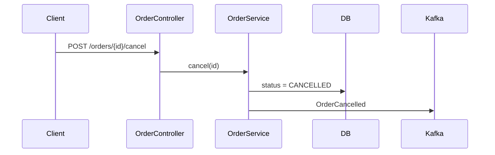

# <ID>: <короткое название>

Статус: draft | approved | done
Тип: feature | bugfix | refactoring
Масштаб: S | M | L
Ветка: feature/<slug> | fix/<slug> | refactor/<slug>
Artifact: <url> | нет

## Задача
<1–3 предложения: что нужно и зачем. Для бага: симптом и ожидаемое поведение.>

## Контекст
- `path/To/Class.java` — <роль в задаче>
- Образец: `path/To/Similar.java` — <что повторяем>

## Решение
<Кратко: как делаем и почему так. Отвергнутые альтернативы — одной строкой.>

## Шаги
- [ ] 1. `path/File` — <что меняется>. Проверка: <как убедиться>
- [ ] 2. ...

## Изменения БД / API / конфигов
- БД: <новая миграция `V..__....sql`: DDL> | нет
- API: <эндпоинт, поля, совместимость> | нет
- Сообщения: <топик/очередь, схема, совместимость, порядок деплоя> | нет
- Конфиги: <свойство = значение по умолчанию, профили> | нет

## Как это будет работать
<Было → стало: 1–3 строки.>

Поток (для M/L):

Данные: <пример запроса / события / строки БД до и после — если меняется формат> | нет
Влияние: <кого затрагивает: другие модули, консьюмеры, отчёты, нагрузка> | нет

Сценарии:
- <условие> → <результат>
- <ошибка / граница> → <результат>

## Риски
- <риск> — <митигация>

## Открытые вопросы
- <вопрос> — блокирует шаг N | нет
